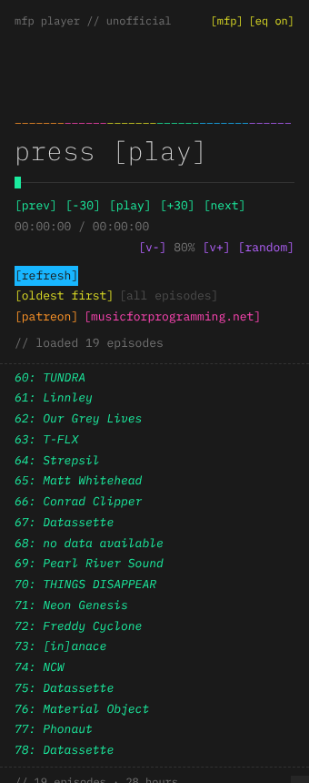

# MFP Player (unofficial)

Play the [Music For Programming](https://musicforprogramming.net) series as a playlist in your Obsidian sidebar.

## Features

- **Playlist:** plays every episode, oldest or newest first, and moves on to the next one automatically.
- **Resume:** remembers where you left off in each episode, even after you restart Obsidian.
- **Favourites:** right-click an episode to add or remove it, or switch to a favourites-only playlist.
- **[refresh]:** checks the official feed for new episodes, only when you press it.
- **Themes:** mfp, invert, mono, amber, and "obsidian", which follows your vault's colours.
- **Extras:** ASCII EQ, now-playing in the status bar (click to play or pause), and media keys.
- **Commands:** play/pause, next, previous, random, skip ±30 s, favourite and more. Assign your own hotkeys in **Settings → Hotkeys**.

## Usage

Click the music-note icon in the left ribbon, or run **MFP Player: Open player** from the command palette. Press **[play]**.

## Network use

This plugin needs the internet to work:

- It fetches the public RSS feed from `musicforprogramming.net` on first run, and when you press **[refresh]**.
- It streams episodes from the official MP3 host (`datashat.net`). Nothing is downloaded, copied or re-hosted.

There's no telemetry and no account. Progress, favourites and settings are stored in the plugin's `data.json` in your vault.

## Desktop only

Marked desktop only, because background audio on mobile is unreliable.

## Support the series

Music For Programming makes no profit and carries no ads. Please consider their [Patreon](https://www.patreon.com/MusicForProgramming/about), and buy music from the artists you discover.

If you like the plugin itself, you can [buy me a coffee](https://buymeacoffee.com/ashotis). Found a bug or have an idea? [Open an issue](https://github.com/AshOtis/mf-player/issues). It's the best way to reach me, and every report gets read.

## Building from source

There are no dependencies. Run `python3 build.py` to write `main.js`, `styles.css` and `manifest.json` to `dist/`.

## Credits and license

This is an unofficial, fan-made plugin, not affiliated with Music For Programming or Datassette. It is made with the permission of the site's owner, given by email. The mixes are streamed directly from musicforprogramming.net and are never copied or redistributed. All music belongs to its artists.

- Code: [PolyForm Noncommercial 1.0.0](LICENSE) © AshOtis: free for personal and other noncommercial use; selling it or using it commercially needs my permission. Versions before this change were released under MIT.
- Font: uses [IBM Plex Mono](https://github.com/IBM/plex) if it's installed on your computer, otherwise your Obsidian monospace font
